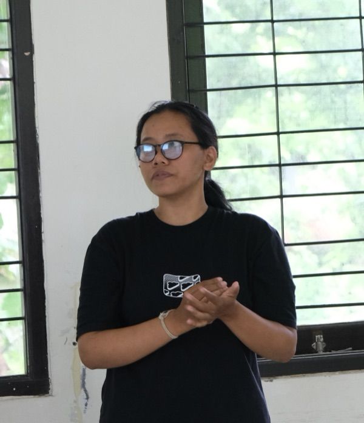

  

    
Infrastructure Engineer · Tech Speaker

    
Hi, I'm Ni Putu Sintia Wati — an Infrastructure Engineer with 3+ years of experience in cloud infrastructure, automation, and observability.

    
I focus on building scalable systems, optimizing developer workflows, and ensuring reliability through Infrastructure as Code, monitoring, and CI/CD.

    
I also love sharing what I learn. I've spoken at events like PyCon ID, AWS Community Day, openSUSE.Asia Summit, and DevFest — you can find my slides on the <a href="/talks/">Talks</a> page.

    
Beyond work, I enjoy improving old projects, reading, writing blogs based on my experiences, and capturing everyday moments through simple <a href="/photos/">photography</a>.

  

  

    
    
Bali, Indonesia

  

  <a href="{{ '/cv/' | relative_url }}">3+ years</a>
  <a href="{{ '/talks/' | relative_url }}">{{ site.data.talks.size }} talks</a>
  <a href="{{ '/blog/' | relative_url }}">{{ site.posts.size }} articles</a>

<h2 class="home-section-title">Timeline</h2>
<ol class="home-timeline">
  
  <li>{{ item.year }}{{ item.text }}</li>
  
</ol>

